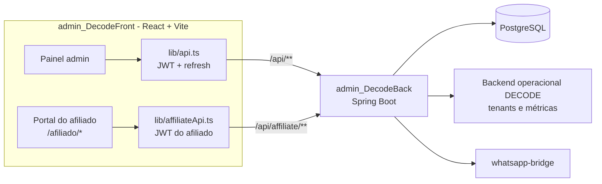

# DECODE Admin Web

Front-end do **painel administrativo do DECODE**, sistema de gestão para lanchonetes, restaurantes, pizzarias e outros estabelecimentos de alimentação. É uma SPA em React + TypeScript com duas áreas na mesma aplicação:

- o **painel administrativo**, onde a equipe do DECODE gerencia estabelecimentos clientes, planos, CRM comercial, afiliados e comissões, tenants do sistema operacional, monitoramento e a sessão de WhatsApp;
- o **portal do afiliado** (`/afiliado/*`), onde parceiros comerciais acompanham indicações e comissões, trabalham os próprios leads e enviam novos estabelecimentos para aprovação.

A API consumida por este projeto está em **[admin_DecodeBack](https://github.com/LeandrSDEV/admin_DecodeBack)** (Java 21 + Spring Boot).

       

---

## Funcionalidades

### Painel administrativo

- **Login com JWT e refresh automático:** um interceptor do Axios renova o token ao receber `401` e repete a requisição original; se o refresh falhar, o usuário volta para o login.
- **Dashboard:** visão consolidada dos tenants (vendas do dia, dos últimos 7 dias e do mês, tendência de 7 dias, pedidos por mesa e delivery, equipe por papel), top 3 afiliados e visão detalhada por afiliado.
- **Clientes:**
  - **Decodes:** estabelecimentos clientes, com histórico e assinatura ativa;
  - **Leads e Interações:** tabelas com busca, paginação, criação/edição em modal e exportação CSV;
  - **Planos:** criar, renovar, cancelar e excluir assinaturas por módulo (mesa, delivery ou completo), com catálogo dos planos no topo.
- **Parceiros:**
  - **Afiliados:** cadastro, aprovação com senha inicial, suspensão e reativação, tela de detalhe com dashboard e estimativa de comissão;
  - **Solicitações de estabelecimento:** aprovação ou rejeição dos fechamentos enviados por afiliados;
  - **Comissões:** geração das comissões do mês e ciclo de *payout runs* (criar, revisar, executar, cancelar, marcar comissão como paga);
  - **Conhecimento:** base de conteúdo comercial sobre o produto (público-alvo, modos de operação, módulos, diferenciais, objeções);
  - **Links:** gera o link do portal e a mensagem de WhatsApp com os dados de acesso para enviar ao afiliado.
- **Tenants:** lista, cadastro, edição e suspensão dos tenants do backend operacional, e modal de configuração do estabelecimento (tipo de estabelecimento, modo de operação mesa/delivery/ambos e recursos como venda por peso, variantes, pré-pedidos, sinal, meio a meio e grupos de modificadores).
- **Monitoramento:** sites monitorados (cadastro rápido, edição, checagem manual, histórico de checagens e incidentes) e métricas do servidor em gráficos, com atualização automática.
- **Usuários:** gestão dos usuários do painel.
- **Configurações:** perfil, troca de senha e **WhatsApp** (status da sessão, QR Code para parear, conectar, reiniciar, desconectar e logout, com *polling* do status).

### Portal do afiliado

- **Login separado**, com token e perfil em chaves próprias do `localStorage`, para que a sessão de admin e a de afiliado convivam no mesmo navegador. Se o backend indicar troca de senha pendente, o primeiro acesso vai direto para o perfil.
- **Painel** com indicações, KPIs e estimativa de comissão do mês.
- **Leads e Interações** do próprio afiliado.
- **Estabelecimentos:** envio de um novo cliente fechado, com o plano escolhido, e acompanhamento do status da solicitação.
- **Comissões:** histórico com totais por status (em carência, aprovada, paga, estornada, retida).
- **Material de vendas** e **Conhecimento** sobre o produto.
- **Perfil:** dados de recebimento (PIX) e troca de senha.

## Arquitetura

| Pasta | Responsabilidade |
|---|---|
| `src/lib/api.ts` | Cliente Axios do painel: injeta o `Bearer` e faz o refresh do token |
| `src/lib/affiliateApi.ts` | Cliente Axios isolado do portal do afiliado (`/api/affiliate/**`) |
| `src/services/` | Funções tipadas por domínio (afiliados, solicitações, portal, WhatsApp bridge) |
| `src/auth/` | Armazenamento de tokens do admin e do afiliado |
| `src/routes/` | *Guards* de rota (`PrivateRoute`, `AffiliatePrivateRoute`) |
| `src/layout/` | `AppShell` (menu lateral recolhível e responsivo do admin) e `AffiliateShell` |
| `src/pages/` | Telas organizadas por domínio |
| `src/components/` | `CrudPage` genérico, `Modal`, `ErrorBoundary`, gráficos e ícones |

**Escolhas técnicas:**

- Dependências de runtime enxutas: React, React Router e Axios. Os gráficos (linha/área e barras) e os ícones são componentes SVG próprios, e o estilo é CSS próprio, sem framework de UI.
- **Configuração em tempo de execução:** no container, o `docker-entrypoint.sh` gera um `/env.js` com `window.__ENV__.VITE_API_BASE_URL` a partir das variáveis do ambiente. A mesma imagem serve para vários ambientes sem novo build. Em desenvolvimento, vale o `.env` do Vite.
- **Nginx** com *fallback* de SPA, `env.js` sem cache e cache imutável para `/assets`.



## Rotas

| Rota | Tela | Área |
|---|---|---|
| `/login` | Login | Pública |
| `/` | Dashboard | Admin |
| `/clientes/decodes` · `/clientes/leads` · `/clientes/interacoes` · `/clientes/planos` | Clientes | Admin |
| `/parceiros/afiliados` · `/parceiros/afiliados/:id` | Afiliados e detalhe | Admin |
| `/parceiros/solicitacoes` · `/parceiros/comissoes` | Solicitações e comissões | Admin |
| `/parceiros/conhecimento` · `/parceiros/links` | Conhecimento e links | Admin |
| `/tenants` · `/monitoramento` · `/usuarios` | Tenants, monitoramento, usuários | Admin |
| `/config/perfil` · `/config/seguranca` · `/config/whatsapp` | Configurações | Admin |
| `/afiliado/entrar` | Login do afiliado | Pública |
| `/afiliado/painel` · `/leads` · `/interacoes` · `/estabelecimentos` | Portal | Afiliado |
| `/afiliado/comissoes` · `/material-vendas` · `/conhecimento` · `/perfil` | Portal | Afiliado |

As URLs antigas `/controle/*` redirecionam para as novas.

## Variáveis de ambiente

| Variável | Uso |
|---|---|
| `VITE_API_BASE_URL` | URL base da API. No Docker é lida em tempo de execução via `env.js`; em dev, pelo `.env` do Vite |
| `VITE_API_URL` | *Fallback* legado para a URL da API |
| `VITE_AFFILIATE_LANDING_URL` | (Opcional) URL da landing de inscrição de afiliados, usada na tela de Links |

## Como rodar localmente

### Pré-requisitos

- Node.js 20.19+ ou 22.12+ (exigência do Vite 7) e npm
- A API [admin_DecodeBack](https://github.com/LeandrSDEV/admin_DecodeBack) rodando (por padrão em `http://localhost:8080`)

### Passos

```bash
git clone https://github.com/LeandrSDEV/admin_DecodeFront.git
cd admin_DecodeFront
npm ci

# aponta o front para a API local
echo "VITE_API_BASE_URL=http://localhost:8080" > .env.local

npm run dev
```

A aplicação sobe em `http://localhost:5173`, origem que já está liberada no CORS padrão da API. O painel fica em `/login` e o portal do afiliado em `/afiliado/entrar`.

### Scripts

| Comando | O que faz |
|---|---|
| `npm run dev` | Servidor de desenvolvimento com HMR |
| `npm run build` | Checagem de tipos (`tsc -b`) e build de produção em `dist/` |
| `npm run preview` | Serve o build localmente |
| `npm run lint` | ESLint (TypeScript, React Hooks e React Refresh) |

### Docker

Build multi-stage (`node:20-alpine` para compilar, `nginx:alpine` para servir):

```bash
docker build -t decode-admin-web .
docker run --rm -p 3000:80 -e VITE_API_BASE_URL=http://localhost:8080 decode-admin-web
```

Nesse exemplo, inclua `http://localhost:3000` em `APP_CORS_ALLOWED_ORIGINS` na API.

## Estrutura de pastas

```text
admin_DecodeFront/
├── Dockerfile               # build Node + Nginx
├── docker-entrypoint.sh     # gera /env.js com a URL da API
├── nginx.conf               # SPA fallback e cache
├── index.html
├── public/knowledge/        # capturas usadas nas telas de conhecimento
└── src/
    ├── main.tsx / App.tsx   # bootstrap e rotas
    ├── auth/                # tokens do admin e do afiliado
    ├── lib/                 # clientes Axios (admin e afiliado)
    ├── services/            # chamadas tipadas à API
    ├── routes/              # guards de autenticação
    ├── layout/              # AppShell e AffiliateShell
    ├── components/          # CrudPage, Modal, ErrorBoundary, charts/, ui/Icons
    └── pages/
        ├── dashboard/       # visão geral
        ├── controle/        # decodes, leads, interações, planos
        ├── afiliados/       # gestão de afiliados, solicitações, comissões
        ├── parceiros/       # conhecimento e links
        ├── afiliado/        # portal do afiliado
        ├── tenants/         # tenants e configuração
        ├── monitoramento/
        ├── usuarios/
        ├── settings/        # perfil, segurança, WhatsApp
        └── login/
```

## Projeto relacionado

- **API:** [admin_DecodeBack](https://github.com/LeandrSDEV/admin_DecodeBack): Spring Boot 3.5, Java 21, PostgreSQL, JWT, Flyway e integrações com o backend operacional e o WhatsApp.

---

Desenvolvido por **Leandro de Jesus Santos** · [LinkedIn](https://www.linkedin.com/in/leandro-js-santos/) · [Portfólio](https://leandrsdev.github.io/portfolio-web/)
